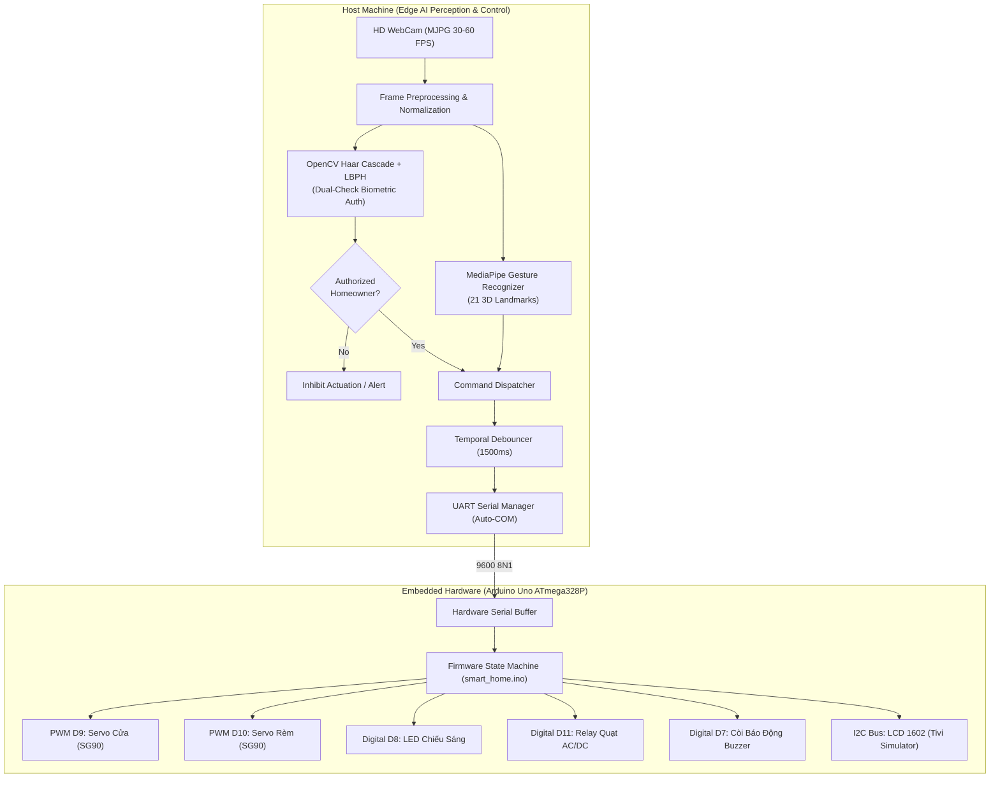
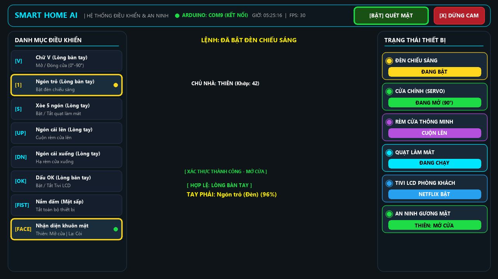

# Edge AI Smart Home: Biometric Gesture & Face Recognition Control System

[](https://www.python.org/)
[](https://opencv.org/)
[](https://developers.google.com/mediapipe)
[](https://www.arduino.cc/)
[](https://wokwi.com/)
[](LICENSE)

An enterprise-grade, edge-computed smart home automation system combining **Google MediaPipe Hand Gesture Recognition** and **OpenCV LBPH Biometric Face Verification** to actuate physical home appliances and security hardware through an **Arduino Uno R3** microcontroller.

---

## Technical Highlights

- **Edge Vision Inference**: 100% offline, low-latency gesture detection via Google MediaPipe Task API (sub-25ms inference on commodity CPUs).
- **Dual-Check Facial Authentication**: Prevents unauthorized bystander commands via Local Binary Patterns Histograms (LBPH) and Haar Cascade classifiers.
- **Hardware-Level Debounce Filter**: Implements a 1500ms temporal refractory engine to eliminate command oscillation and servo jitter.
- **Decoupled Architecture**: High-level computer vision and low-level ATmega328P firmware communicate via an asynchronous 9600-baud UART protocol.
- **Fault-Tolerant Fallback**: Automatically activates software simulation mode when physical hardware is disconnected, enabling headless testing on Wokwi.

---

## System Architecture



Detailed technical specifications:
- [System Architecture Specification](docs/ARCHITECTURE.md)
- [UART Communication Protocol](docs/COMMUNICATION_PROTOCOL.md)
- [Hardware Pinout & Circuit Schematic](docs/HARDWARE_SPEC.md)

---

## Live Dashboard & Hardware Pinout

### 1. Edge AI Visual Dashboard
Real-time optical feed displaying biometric owner verification, 21-point hand landmark tracking, active gesture classification, and hardware actuation telemetry.



### 2. Circuit Schematic & Electrical Wiring
Standardized connection diagram for Arduino Uno R3, dual SG90 micro servos, I2C LCD 1602, active piezo buzzer, and optocoupler relay module.


---

## Gesture Command Mapping

| Gesture | Representation | Action | Hardware Actuator | Serial Byte |
|---|:---:|---|---|:---:|
| **Victory** | `V` | Mở Cửa chính | Servo D9 xoay 90° | `'O'` |
| **Thumb Down** | `Down` | Đóng Cửa chính | Servo D9 xoay 0° | `'C'` |
| **Thumb Up** | `Up` | Kéo Rèm cửa lên | Servo D10 xoay 90° | `'U'` |
| **Pointing Up** | `Index` | Thả Rèm cửa xuống | Servo D10 xoay 0° | `'D'` |
| **Open Palm** | `Palm` | Bật/Tắt Đèn phòng khách | Digital D8 Invert | `'L'` |
| **OK / Pinch** | `OK` | Bật/Tắt Tivi mô phỏng | LCD 1602 I2C Display Mode | `'T'` |
| **ILoveYou** | `Rock` | Kích hoạt Báo động SOS | Digital D7 & D8 Strobe | `'S'` |
| **Closed Fist** | `Fist` | Ngắt toàn bộ hệ thống | Safe Mode (Đóng cửa, hạ rèm, tắt đèn) | `'X'` |

---

## Project Directory Layout

```plaintext
SmartHome_HandGesture/
├── ai_module/                              # Edge AI Computer Vision & Control Service
│   ├── dataset/                            # Training sample directory (protected via gitignore)
│   │   └── .gitkeep
│   ├── dang_ky_chu_nha.py                  # Face biometric enrollment & training engine
│   ├── face_core_model.yml                 # Primary face recognition model weights
│   ├── face_model.yml                      # Dual-check face recognition model weights
│   ├── gesture_recognizer.task             # Google MediaPipe hand gesture model
│   ├── hand_landmarker.task                # Google MediaPipe hand landmark model
│   ├── haarcascade_frontalface_default.xml # OpenCV Haar Cascade face detector
│   ├── main.py                             # Edge AI core runtime & serial controller
│   ├── requirements.txt                    # Python runtime dependencies
│   └── run_wrapper.py                      # Crash recovery runner
├── arduino_module/                         # Embedded Firmware & Hardware Simulation
│   ├── smart_home/
│   │   └── smart_home.ino                  # Arduino Uno R3 production firmware (UART, PWM, I2C)
│   ├── i2c_scanner/
│   │   └── i2c_scanner.ino                 # I2C address diagnostic utility
│   ├── diagram.json                        # Wokwi simulation circuit board definition
│   └── wokwi.toml                          # Wokwi simulator entrypoint
├── docs/                                   # Engineering Documentation & Architecture
│   ├── assets/                             # Schematics, UI previews & vector graphics
│   │   ├── SoDo_DauDay_SmartHome.svg
│   │   ├── ui_preview_vietnamese.png
│   │   ├── ui_preview_updated.png
│   │   └── ui_preview_modern.png
│   ├── ARCHITECTURE.md                     # Architecture specification & latency metrics
│   ├── COMMUNICATION_PROTOCOL.md           # UART protocol specification
│   └── HARDWARE_SPEC.md                    # Pinout mapping, BOM, and electrical considerations
├── tools/                                  # Developer Utilities & Diagram Generators
│   └── generate_wiring_diagram.py          # Automated SVG schematic builder
├── BAT_CAMERA_AI.bat                       # 1-click Windows launcher for AI camera
├── DANG_KY_CHU_NHA.bat                     # 1-click Windows launcher for biometric enrollment
├── KIEM_TRA_PHAN_CUNG.bat                  # Hardware connection self-test launcher
├── LICENSE                                 # MIT License
├── README.md                               # Project documentation
└── requirements.txt                        # Global Python dependency manifest
```

---

## Getting Started

### 1. Prerequisites
- Python 3.10+ (tested on Windows 10/11)
- Arduino IDE (optional if using Wokwi)
- USB WebCam (720p or 1080p recommended)

### 2. Python Environment Setup

```bash
# Navigate to the repository root
cd SmartHome_HandGesture

# Create and activate virtual environment
python -m venv venv
.\venv\Scripts\activate   # Windows
# source venv/bin/activate # Linux / macOS

# Install required dependencies
pip install -r requirements.txt
```

### 3. Hardware Deployment (Arduino Uno)
1. Open [arduino_module/smart_home/smart_home.ino](arduino_module/smart_home/smart_home.ino) in the Arduino IDE.
2. Install required libraries from Library Manager:
   - `LiquidCrystal_I2C` (by Frank de Brabander)
   - `Servo` (Standard library)
3. Connect the Arduino Uno via USB, verify the port (e.g. `COM9`), and click **Upload**.

### 4. Running the AI System
Launch via the convenient Windows batch script:
```cmd
BAT_CAMERA_AI.bat
```
Or execute directly with Python:
```bash
python ai_module/main.py
```

### 5. Running in Simulation (Wokwi)
If physical microcontroller hardware is unavailable:
1. Open the repository in VS Code with the **Wokwi Simulator** extension.
2. Open `arduino_module/diagram.json`.
3. Press `F1` and select `Wokwi: Start Simulator` to evaluate the firmware logic in-browser.

---

## Author & Licensing

- **Author**: Le Vu Thien ([@thienlotus](https://github.com/thienlotus))
- **License**: Released under the [MIT License](LICENSE).
