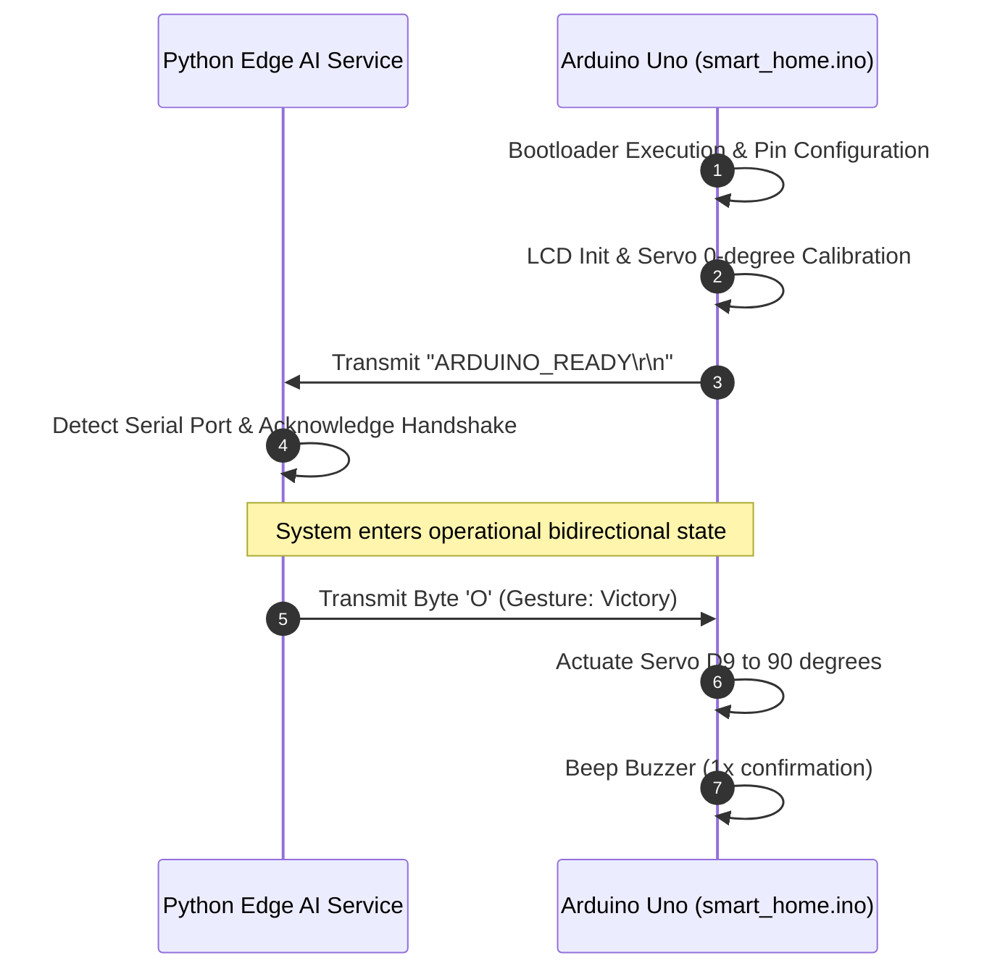

# UART Serial Communication Protocol Specification

## 1. Physical & Framing Layer

| Parameter | Specification |
|---|---|
| **Interface** | Universal Asynchronous Receiver-Transmitter (UART) via USB Serial Bridge |
| **Default Baud Rate** | 9600 bps |
| **Data Bits** | 8 |
| **Parity** | None |
| **Stop Bits** | 1 |
| **Flow Control** | None |
| **Default Port** | `COM9` (fallback to dynamic COM auto-discovery) |

---

## 2. Packet Format & Command Matrix

To ensure deterministic, low-overhead execution on 8-bit microcontrollers (ATmega328P with 2KB SRAM), commands are transmitted as atomic single-byte ASCII characters.

| Command Byte | ASCII Code | Hex | Target Actuator | Action Description | Hardware Output State |
|:---:|:---:|:---:|---|---|---|
| `'O'` | 79 | `0x4F` | Main Door Servo | Unlock & Swing Open | PWM D9: 90° angle |
| `'C'` | 67 | `0x43` | Main Door Servo | Swing Closed & Lock | PWM D9: 0° angle |
| `'U'` | 85 | `0x55` | Window Curtain Servo | Retract & Roll Up | PWM D10: 90° angle |
| `'D'` | 68 | `0x44` | Window Curtain Servo | Deploy & Lower Curtain | PWM D10: 0° angle |
| `'L'` | 76 | `0x4C` | Living Room Lighting | Toggle Illumination | Digital D8: Invert (HIGH/LOW) |
| `'T'` | 84 | `0x54` | Simulated Television | Toggle Display Power | I2C LCD 1602: Toggle Backlight / Channels |
| `'S'` | 83 | `0x53` | Security & Alert System | Trigger SOS Strobe | Digital D7 & D8: 150ms synchronous strobe |
| `'X'` | 88 | `0x58` | All Subsystems | Emergency Standby / All Off | D9: 0°, D10: 0°, D8: LOW, LCD: Standby |

---

## 3. Handshake & Initialization Sequence

---

## 4. Fault Tolerance & Simulation Fallback

When no physical hardware is plugged into the host workstation:
1. `main.py` catches `serial.SerialException`.
2. Seamlessly switches to **Simulation Mode (`Simulation Mode = True`)**.
3. All commands and state machine transitions remain operational on the visual UI dashboard and logs, facilitating continuous software development and Wokwi web simulator testing without requiring physical boards.
